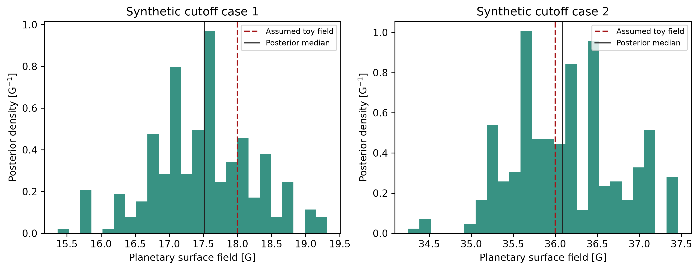

# Aegis
What would it take to hear an exoplanet's magnetic field? We use Aegis to predict radio emission driven by cyclotron maser instability (CMI), propagate uncertain system properties through stellar-wind and planetary-emission models, and compare the resulting frequency and flux distributions with telescope sensitivities. The predictions depend on the adopted wind, spin, and magnetic-field assumptions, which are worth inspecting before choosing a target.

## Installation
The required packages are listed in `environment.yml` and `requirements.txt`.

## Repository paths
`AEGIS_PATH` points to the Aegis checkout used by the analysis scripts. When it is unset, Aegis uses the directory containing `repository_paths.py`. The checkout's `data/` and `visuals/` directories are ignored by Git for local inputs and generated figures.

## Example use
Start with a NASA Exoplanet Archive table containing the required system parameters. Save it as `NASA[sample].csv`, where `[sample]` is usually the download date in DDMM format. The scripts use that sample label to connect their inputs and outputs.


## Radio catalog

We publish five selected predicted targets in a searchable radio
catalog. The page sorts by target, maximum frequency, or predicted flux and
filters by name and frequency. These are model predictions, not detections.

To rebuild the site data from `append_table.csv`, run:

```bash
python publish_radio_catalog.py --check-physicality
```

The catalog is published at <https://astromusers.github.io/aegis/> when the
GitHub Pages environment is enabled for this repository.

## Calculations

### Planetary spin
`rotation_script.py` samples exoplanet spin angular momenta from the Solar System distribution in `rotation.csv`. The resulting spin distribution enters the planetary magnetic-field and radio-emission calculations.

### Stellar wind
`wind.py` calculates the stellar-wind temperature and speed at each planet's orbit with an isothermal Parker wind model (Parker 1958). It reads the NASA Exoplanet Archive sample and writes `stellar_wind_predictions_[sample].tsv` for the radio-emission calculation.

### Radio emission
`exoplanet_predictions.py` propagates uncertainties in NASA Exoplanet Archive measurements through the magnetic-field and radio-emission models with Monte Carlo sampling. It calculates predictive distributions of emission frequency and radio flux density for each target.

### Magnetic-field inference
For a detected cyclotron-maser cutoff, `magnetic_field_inference.py` estimates the surface field from Aegis's cutoff-frequency relation and a Gaussian measurement likelihood. Install the dependencies in `requirements.txt`, then run the explicitly synthetic example with `python examples/infer_magnetic_field.py`. The fit uses a uniform magnetic-field prior and complements the forward Monte Carlo predictions with an observation-driven estimate.

The [cutoff-inference notebook](examples/magnetic_field_cutoff.ipynb) compares
two seeded synthetic measurements by passing them through
`infer_surface_field()`. It displays the returned PCAT posterior intervals and
their distributions. These toy inputs exercise the likelihood and sampling
workflow; they are not radio observations or field measurements of real
exoplanets. The short chains illustrate the API and do not establish
convergence.



The calculation requires the exoplanet archive table in comma-separated value format. We use 10,000 Monte Carlo samples. Reduce the count for faster exploratory calculations. The script also writes `df1.csv` and `all.npz` for the population figures. These draws propagate stated measurement uncertainties and the empirical Solar System spin distribution through a forward model. The cutoff fit above estimates a model parameter from an observed frequency.

### Emission and observability figures
`plotter.py` plots the Monte Carlo predictive emission-frequency and radio-flux distributions from `df1.csv` and `all.npz`. The `nenufar.npz` and `sensitivities.csv` inputs add the sensitivity limits of NenuFAR and other radio telescopes.

For an interactive target view with hover values, uncertainty bars, and telescope sensitivity curves, install Bokeh and save the returned figure as HTML:

```python
from bokeh.io import output_file, save
from plotter import df, scatter_plot_bokeh, x_err, y_err

output_file("visuals/radio_predictions_bokeh.html")
save(scatter_plot_bokeh(df, "both", y_err, x_err))
```

`outcome_dist_hists()` and `scatter_plot()` use white backgrounds with black
axes by default. Pass `typeplotback='dark'` for black backgrounds with white
axes, including saved figures. They also inherit an enclosing TDpy
`plot_style()` theme without changing later plots.

`parker_spiral.py` plots the interplanetary magnetic-field component at the orbit of tau Boo b from `taub_wind.npz`. `visibility.py` maps maximum elevation and time above 20 degrees for the considered telescopes using `obs_table.csv`. `radius_valley.py` compares the planetary radii and predicted magnetic-field strengths in `Output Tables/all.csv`. `sketch.py` draws the magnetized-exoplanet geometry.

### Monte Carlo sensitivity
`does_it_make_a_difference.py` quantifies how Monte Carlo uncertainty propagation changes the predicted radio-emission distributions relative to calculations based only on nominal input values.

## Output tables
`exoplanet_predictions.py` writes radio flux densities and maximum emission frequencies for the magnetic, kinetic, and combined radiometric Bode-law predictions. `Output Tables/all.csv` contains the combined predictions and uncertainties for every exoplanet. Five additional tables divide the targets by predicted frequency. The text tables under `Old Result Tables` sort potentially visible candidates by name, frequency, and flux density.

`extract.py` and `append.py` produce `final-table.csv` and `append.csv`, the two manuscript tables.


## Known limitations
Known limitations are summarized in `known_problems.md`.


# Acknowledgements

The development of aegis has been supported by the McDonnell Center for Space Sciences at Washington University in St. Louis.
